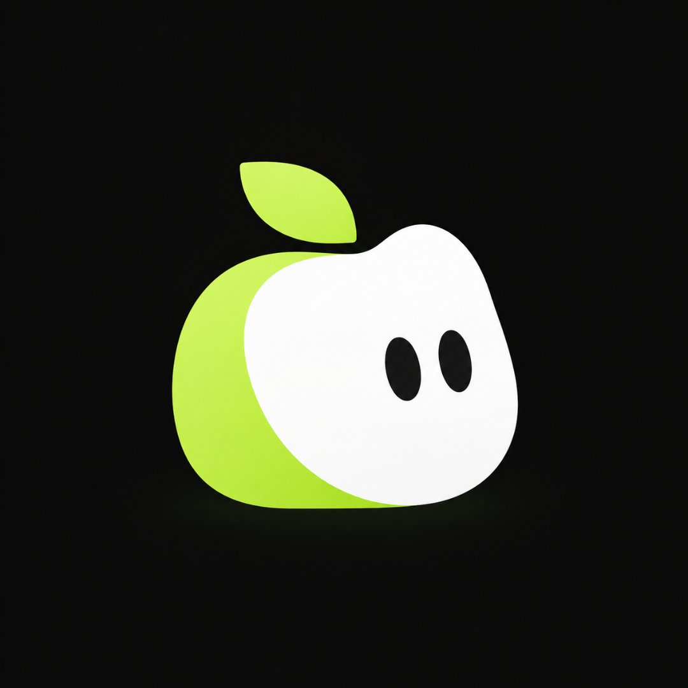

<p align="center">
  
</p>

<h1 align="center">Fyin</h1>

<p align="center">
  Suas finanças num lugar só, sincronizadas da <a href="https://pluggy.ai">Pluggy</a> (Meu Pluggy) para um app iOS.
</p>

<p align="center">
  <a href="#como-funciona">Como funciona</a> ·
  <a href="#começando">Começando</a> ·
  <a href="#api">API</a> ·
  <a href="#testes">Testes</a> ·
  <a href="#estrutura">Estrutura</a>
</p>

---

O Fyin puxa contas, faturas, transações, empréstimos e investimentos da Pluggy, guarda tudo num Postgres local e mostra um resumo mensal no iPhone. O Fy, a maçã da capa, é o mascote do app. O design no Pencil (`Fyin.pen`) tem variações dele para os estados do app.

> **Status:** em desenvolvimento. A API roda só em `localhost` e a autenticação é um token compartilhado. Não é pensada para produção ainda.

## Como funciona

```
Pluggy API ──► cmd/sync ──► Postgres ──► cmd/api ──► app iOS
                  ▲                          │
                  └──── botão sincronizar ───┘
```

- **`cmd/sync`** copia os itens configurados (`ITEMS`) da Pluggy para o banco e lista as divergências entre o saldo informado e o calculado.
- **`cmd/api`** serve o app iOS por HTTP, protegido por `Authorization: Bearer <API_TOKEN>`. Também dispara a sincronização de um item ou de todos.
- **Postgres** guarda o espelho dos dados, com o schema em `migrations/`.
- **App iOS** (SwiftUI) consome a API e mostra a tela inicial com o resumo do mês.

## Stack

- Go 1.27 com [pgx](https://github.com/jackc/pgx) e testes com [testify](https://github.com/stretchr/testify)
- Postgres 18 via Docker Compose
- SwiftUI para iOS 26, com a fonte Urbanist

## Começando

### Pré-requisitos

- [Docker](https://www.docker.com/) (para o Postgres)
- Go 1.27 ou superior
- Xcode com o SDK do iOS 26, para o app
- Credenciais da Pluggy (`CLIENT_ID` e `CLIENT_SECRET`) e os IDs dos itens que você quer sincronizar

### 1. Configurar o ambiente

```bash
cp .env.example .env
```

Preencha o `.env`:

| Variável | Para que serve |
| --- | --- |
| `CLIENT_ID`, `CLIENT_SECRET` | Credenciais da API da Pluggy |
| `DATABASE_URL` | Conexão com o Postgres (o padrão aponta para o Docker Compose) |
| `ITEMS` | Lista `dono:itemId` separada por vírgula, com os IDs do Dashboard da Pluggy |
| `API_TOKEN` | Token que o app iOS envia no cabeçalho `Authorization` |

O `.env` está no `.gitignore`. Não o versione.

### 2. Subir o banco e sincronizar

```bash
make up      # Postgres em 127.0.0.1:5433; as migrations rodam no primeiro boot do volume
make sync    # copia os itens da Pluggy para o banco
make api     # sobe a API em http://127.0.0.1:8080
```

`make psql` abre um shell no banco. Para validar um item direto na Pluggy, sem banco, use `./check.sh <itemId>`.

### 3. Rodar o app iOS

1. Copie o modelo de configuração:

   ```bash
   cp ios/Secrets.swift.example ios/Fyin/App/Secrets.swift
   ```

2. Em `ios/Fyin/App/Secrets.swift`, preencha `apiToken` com o mesmo valor de `API_TOKEN`. O arquivo está no `.gitignore`.
3. Abra `ios/Fyin.xcodeproj`, escolha um simulador e rode. A API precisa estar de pé (`make api`), porque o app fala com `http://127.0.0.1:8080`.

## API

Todas as rotas exigem `Authorization: Bearer <API_TOKEN>`.

| Método | Rota | O que faz |
| --- | --- | --- |
| `GET` | `/v1/home?month=YYYY-MM` | Resumo do mês (padrão: mês atual) |
| `GET` | `/v1/items` | Lista os itens sincronizados |
| `GET` | `/v1/items/{id}` | Detalhe e andamento de um item |
| `POST` | `/v1/items/{id}/sync` | Sincroniza um item; responde `202` e o andamento segue em `GET` |
| `POST` | `/v1/sync` | Sincroniza todos os itens; responde `202` |

## Testes

```bash
make up      # os testes de integração usam o Postgres de verdade
make test    # go test ./...
```

- **Integração por padrão.** Os testes em `integrationtests/` clonam um banco de um template (`internal/testdb`) já migrado. Storage nunca é mockado.
- **A Pluggy é substituída** por um fake em `integrationtests/fake_pluggy_test.go`, então os testes não gastam a API real.
- **Cliente HTTP** testado com `httptest` em `internal/pluggy/client_test.go`.

O guia de testes do projeto está em [AGENTS.md](AGENTS.md).

## Estrutura

```
cmd/
  api/            entrypoint da API HTTP
  sync/           entrypoint da sincronização com a Pluggy
internal/
  home/           resumo mensal: store, service e handler
  items/          itens sincronizados: service e handler
  pluggy/         cliente HTTP da API da Pluggy
  sync/           sincronização e redação de segredos nos logs
  testdb/         banco de teste clonado de um template
integrationtests/ testes de integração com a Pluggy falsa
migrations/       schema SQL, embutido no binário
ios/              app SwiftUI (Fyin.xcodeproj)
assets/mascot/    mascote Fy
Fyin.pen          design no Pencil
```

## Segurança

- A API escuta só em `127.0.0.1` e autentica com um token compartilhado. Ao sair de `localhost`, a troca para TLS e autenticação por usuário é obrigatória.
- Credenciais da Pluggy, `.env` e `Secrets.swift` ficam fora do repositório.
- A sincronização redige segredos antes de escrever nos logs (`internal/sync/redact.go`).

Se encontrar um problema de segurança, não abra uma issue pública com os detalhes. Entre em contato direto com o mantenedor.

## Licença

Ainda não definida.
